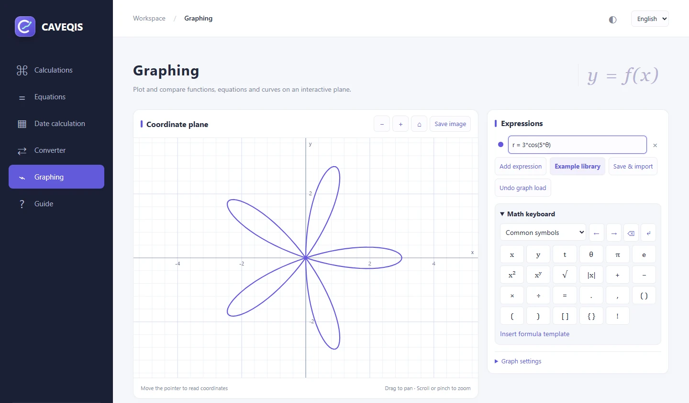

# CAVEQIS

An offline mathematics toolbox for symbolic and numerical calculations, equation solving, and interactive graphing. CAVEQIS runs on Windows, Linux, and Android without an account.

[Downloads](#downloads) · [Documentation](#documentation) · [Report an issue](https://github.com/fengyundn/caveqis/issues)

[](https://github.com/fengyundn/caveqis/releases/latest)



## Downloads

All three installers are available in the [CAVEQIS v1.1.0 release](https://github.com/fengyundn/caveqis/releases/tag/v1.1.0).

| Platform | Installer |
| --- | --- |
| Windows 10 and 11 (x64) | [Download Windows installer](https://github.com/fengyundn/caveqis/releases/download/v1.1.0/CAVEQIS-Setup-1.1.0-win-x64.exe) |
| Linux (x86-64) | [Download Linux `.deb`](https://github.com/fengyundn/caveqis/releases/download/v1.1.0/CAVEQIS-1.1.0-linux-amd64.deb) |
| Android | [Download Android `.apk`](https://github.com/fengyundn/caveqis/releases/download/v1.1.0/CAVEQIS-1.1.0-android.apk) |

## Overview

- **Symbolic and numerical calculations.** Evaluate exact expressions, simplify or factor algebra, work with matrices and determinants, and compute derivatives, integrals, limits, and series.
- **Equation solving.** Solve single-variable equations, systems of equations, and selected matrix, differential, and integral equations.
- **Interactive graphing.** Plot functions, implicit relations, inequalities, parametric curves, polar curves, and statistical charts. Explore the examples, adjust parameters with sliders, and export plots as PNGs.
- **Everyday utilities.** Convert units and calculate date differences. Switch between English and Simplified Chinese or choose a light or dark theme.

The desktop apps open in their own windows. The Android app includes an on-screen numeric keypad for entering expressions. A browser edition can also run locally or on a server. CAVEQIS uses SymPy for symbolic computation and KaTeX for formula rendering.

## Installing

- **Windows.** Run the `.exe` and open **CAVEQIS** from the Start menu. The installer is unsigned, so Windows may show an unknown-publisher prompt.
- **Linux.** On Debian 12 x86-64, run `sudo apt install ./CAVEQIS-1.1.0-linux-amd64.deb` from the download directory. Then open **CAVEQIS** from your application menu.
- **Android.** Open the `.apk` on your device to install it. If Android prompts you, allow app installation from the browser or file manager you used to open the file.

## Run from source

With Python 3.10 or newer, run these commands from the repository root.

```powershell
python -m venv .venv
.\.venv\Scripts\python.exe -m pip install -r requirements.txt
.\.venv\Scripts\python.exe app.py
```

On Linux or macOS, use `.venv/bin/python` in the last two commands. Open the local app at `http://127.0.0.1:8765/`.

### Docker

```sh
docker build -t caveqis .
docker run --rm -p 127.0.0.1:8765:8765 caveqis
```

Open `http://127.0.0.1:8765/` in your browser. The [deployment templates](deploy/) cover Nginx reverse proxying and a systemd service.

### Build the Windows installer

On Windows x64, use PowerShell 7, Python 3.12 x64, and Node.js 22.12 or newer with npm.

```powershell
.\desktop\build-windows.ps1
```

The installer is written to `desktop/dist/`. If the Windows Python launcher cannot find Python 3.12, pass its executable path with `-PythonExe`.

## Documentation

Open the in-app guide for input syntax and worked examples. The [detailed user and deployment guide](docs/user-guide.zh-CN.md) is available in Simplified Chinese.

## Reporting issues

When opening an [issue](https://github.com/fengyundn/caveqis/issues), include the CAVEQIS version, your operating system, and the exact expression or steps that reproduce the problem. For graphing issues, include the expressions and any parameter values or axis limits that matter.

## Development

Install the Python requirements in your virtual environment and run `python -m unittest discover -s tests` with that environment active. For frontend checks, run `npm ci --ignore-scripts` and then `npm test` from the repository root.
